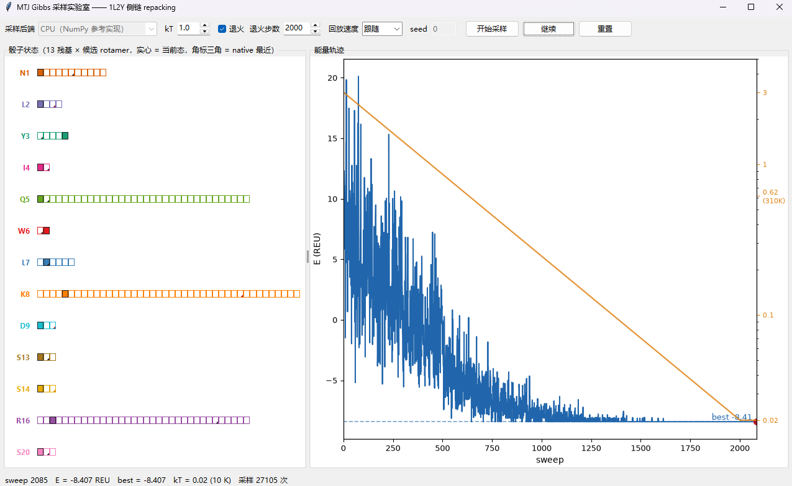
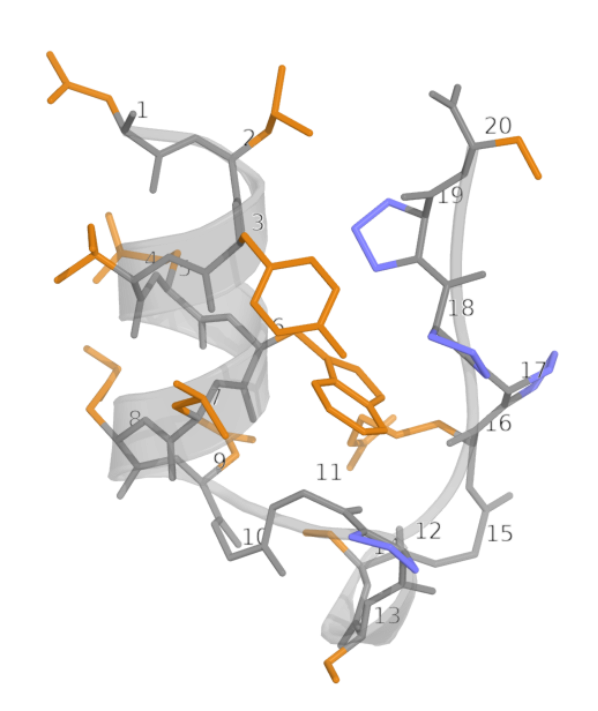
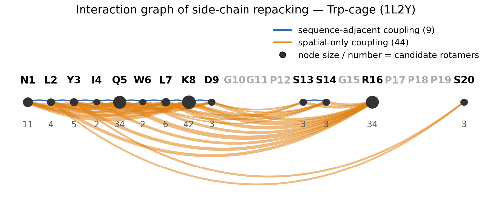

# p-bit 概率计算硬件驱动的蛋白质侧链构象 Gibbs 采样

github: https://github.com/Varato/pBit-Gibbs-Sampling-for-Protein-Repacking

用 **MTJ（磁隧道结）p-bit 阵列 + FPGA 作为物理随机源**做 Gibbs 采样，演示
问题为 1L2Y（Trp-cage）侧链 repacking。Gibbs 的每一步中，唯一的随机操作
是从一个 K 维条件分布里抽一个类别（Categorical）；把这一步交给物理器件，
物理熵源就替换了伪随机数发生器。核心采样接口形式如下（下文详述）：

```python
k = categorical_sample(p)     # p: 离散概率向量 → k: 抽中的下标
```

温度 / 能量 / Boltzmann 折算全部在引擎侧（`engine.cond_probs`）完成，
硬件侧拿到的 `p` 已是归一概率数组。蛋白相关的数据（能量表、构型候选池）已预先算好，在 `data/` 下，详见下文。

## 采样接口（`sampler/base.py`）

随机源统一实现 `CategoricalSampler`，核心一个方法：

```python
class CategoricalSampler(ABC):
    blocking: bool = False          # 单次调用是否耗时秒级以上（引擎据此上报逐残基进度）
    dyn_range: float | None = None  # 概率动态范围上限 p_max/p_min；None = 不限

    def categorical_sample(self, p: ArrayLike) -> int:
        """p: 一维非负数组，Σp≈1，长度 K 每次调用可变（本问题 2..42）
           返回 int k ∈ 0..K-1，统计上服从 Categorical(p)"""
```

错误语义：单次失败抛 `RuntimeError`（引擎重试 ≤3 次，仍败该残基保持
原态）；设备不可用抛 `HardwareUnavailable`（立即终止）。其余细节见
`base.py` 注释。

## 快速开始与验证

```bash
python -m venv .venv
.venv/Scripts/pip install -r requirements.txt    # Linux/macOS 用 .venv/bin/
.venv/Scripts/python selftest.py                 # 独立复现自检（应 6/6 PASS）
.venv/Scripts/python -m pytest tests -q          # 应 10 项全 PASS（含 GUI 冒烟）
.venv/Scripts/python check_sampler.py --backend cpu   # 验收协议，4/4 PASS
.venv/Scripts/python main.py                     # 打开 GUI
```

代码实现了一个简易 GUI 方便观察运行过程。GUI 默认"退火"模式 + CPU
后端，13 行骰子实时翻转，能量曲线收敛到 GMEC −8.41（蓝虚线），右轴
橙线 = kT 降温日程：



图上每行一个残基：实心格 = 当前采中的 rotamer，灰带 = 本 sweep 翻过的
行；方格右下角的小三角标出离实验构象（native）最近的候选 rotamer。
native 是实验测定的静态构象（1L2Y 的 NMR model 1）。

## 接入 MTJ 硬件

硬件后端在 `sampler/mtj.py`（桩，TODO 标出待填的类属性与实现位置）：
实现上一节的 `categorical_sample(p)` 即可，怎么实现由硬件侧定。完成后跑
`python check_sampler.py --backend mtj --n 100` 验收。

## 文件一览

| 文件 | 作用 |
|---|---|
| `main.py` / `gui.py` | GUI 入口 / 主窗口（控制面、回放、状态栏） |
| `engine.py` | Gibbs 引擎：条件能量 → softmax → `categorical_sample(p)`（零 GUI 依赖） |
| `worker.py` | 采样线程 + 帧缓冲（采集/回放分离，min-max 对折保峰谷） |
| `sampler/base.py` | ★ 采样器接口契约（`CategoricalSampler`、`HardwareUnavailable`、`SamplerStats`、`clip_dyn_range`） |
| `sampler/cpu.py` | CPU 参考实现（Gumbel-max，数学严格等价，对拍基准） |
| `sampler/mtj.py` | ★ MTJ + FPGA 硬件桩（2 个 TODO） |
| `canvaspanel.py` / `plotting.py` | 13 行骰子画布 / 能量轨迹面板 |
| `check_sampler.py` / `selftest.py` / `tests/` | 采样器验收协议 / 独立自检 / pytest |


## 术语

| 术语 | 定义 |
|---|---|
| 主链 / 侧链 | 主链（backbone）是 N–Cα–C 重复单元构成的蛋白质骨架；侧链（side chain）是连接在 Cα 上、随氨基酸种类而异的部分，决定残基间的化学相互作用。 |
| φ / ψ / χ 角 | 描述构象的二面角（°）：φ、ψ 描述主链，χ₁、χ₂、… 描述侧链的各可旋转键。 |
| rotamer（旋转异构体） | 侧链 χ 角的一组离散稳定取值（高分辨实验结构中 χ 角聚成少数几个簇）。侧链构象本身连续，用离散 rotamer 近似后，侧链状态才能建模为组合问题。 |
| rotamer 库（Dunbrack 库） | 按残基类型与主链 φ/ψ 统计的 rotamer 集合（χ 峰心 + 出现概率）。本仓的候选池由 PyRosetta packer 按主链构象从库中剪枝而来（即"v1 截断池"，152 候选）。 |
| 侧链 repacking | 固定主链骨架与氨基酸序列，为每个残基从其 rotamer 池中选一个构象，使整体能量最低（或按 Boltzmann 分布采样）的组合优化问题。 |
| native 构象 | 实验测定的静态构象；本项目指 1L2Y 的 NMR model 1。用作参照：离 native χ 最近的候选在 GUI 中标为方格右下角小三角。 |
| GMEC | global minimum energy conformation，全构型空间中能量的全局最优解；本问题为 E = −8.407 REU。 |
| REU | Rosetta Energy Unit：PyRosetta `ref2015` 全原子打分函数的无量纲单位（近似按 kcal/mol 标定）。本仓所有能量（`E_self`、`E_int`、E、kT、GMEC）的单位。 |

## 问题简述：1L2Y 侧链 repacking

PDB 1L2Y 是 20 残基的 Trp-cage 迷你蛋白（NMR 结构，折叠最快的已知蛋白之一）：
N 端 α 螺旋（残基 2–9）包裹中心 Trp6 吲哚环，C 端富 Pro 肽段封口成"笼"。



序列 `NLYIQWLKDGGPSSGRPPPS`，共 20 个残基。其中 Gly（10/11/15）无侧链、
Pro（12/17/18/19）侧链刚性，这 7 个固定不动，其余 **13 个残基**各持有一个
离散 rotamer 候选池，规模 K = [11, 4, 5, 2, 34, 2, 6, 42, 3, 3, 3, 34, 3]
（ΣK = 152，来自 Dunbrack 库按主链 φ/ψ 剪枝）。残基间的能量耦合构成一个
图：**53 条边** = 9 条序列相邻 + 44 条仅空间邻近：



## 哈密顿量与计算复杂度

哈密顿量通过查能量表（事先算好 `data/energy_table.json`）获得。

### 能量表 = Potts 分解

全原子能量函数在固定主链、离散 rotamer 的前提下分解为局部因子：

$$E(\mathbf{x}) \;=\; \sum_{i=1}^{N} E_{\mathrm{self}}(i,\,k_i)\;+\;\sum_{(i,j)\in\mathcal{E}} E_{\mathrm{int}}(i,\,k_i;\,j,\,k_j)$$

其中 $N$ 为残基数，$\mathbf{x}=(k_1,\dots,k_N)$ 为各残基的候选下标组合。$i, j$ 索引氨基酸，$k_i, k_j$ 索引对应氨基酸的构象。

### 多项式的表，指数的空间

设平均每残基候选数为 $\bar K$、平均图度数（每个氨基酸几何可达的邻居数）为 $\bar c$，则构造能量表所需的
能量评估次数为

$$C_{\mathrm{table}} \;=\; \underbrace{N\bar K}_{\text{自能}}\;+\;\underbrace{\tfrac{N\bar c}{2}\,\bar K^{2}}_{\text{成对交互}}\;\sim\;O(N)$$

$\bar K$、$\bar c$ 由残基类型与剪枝判据决定，近似与蛋白长度无关，因此
**表构造随蛋白长度线性增长**。而整体构型空间的大小为

$$|\Omega| \;=\; \prod_{i=1}^{N} K_i \;\le\; \bar K^{\,N} \;\le\; \langle K^{N}\rangle$$

（左不等号：AM–GM；右不等号：$x\mapsto x^N$ 为凸函数，Jensen 不等式。）
即构型数随残基数**指数**增长，在其中找 GMEC 是 NP-hard 问题。

本问题的具体数值：

| 量 | 符号 | 数值 |
|---|---|---|
| 参与 repacking 的残基数 | $N$ | 13 |
| 候选总数 | $\sum_i K_i$ | 152 |
| 平均每残基候选数 | $\bar K$ | ≈ 11.7 |
| 相互作用边数（$=N\bar c/2$） | $\|\mathcal{E}\|$ | 53（9 序列 + 44 空间） |
| 平均度 | $\bar c$ | ≈ 8.2 |
| 能量表条目数 | $C_{\mathrm{table}}$ | 152 + 8077 = **8229** |
| 构型空间大小 | $\|\Omega\|$ | ≈ **2.1×10¹⁰**（上界 $\bar K^N$ ≈ 7.6×10¹³） |

8229 个数定义了 2×10¹⁰ 个构型中每一个的能量（因子求和即得）。要对这个
空间做完整推断（配分函数 $Z=\sum_{\mathbf{x}} e^{-E(\mathbf{x})/kT}$、各残基边缘分布、
GMEC），都需要遍历 $\Omega$，代价 $|\Omega|\sim\bar K^N$。N=13 时尚可一搏；真实蛋白 $N\sim10^2$–$10^3$。

### Gibbs 采样

Gibbs 采样按残基轮转，从全条件分布中抽样。残基 $i$ 的条件能量向量只涉及
自身因子与邻居因子：

$$v_i(k) \;=\; E_{\mathrm{self}}(i,k)\;+\;\sum_{j\in\mathrm{nbr}(i)} E_{\mathrm{int}}(i,k;\,j,k_j),
\qquad
p(k_i=k\mid k_{-i}) \;=\; \frac{e^{-v_i(k)/kT}}{\sum_l e^{-v_i(l)/kT}}$$

条件分布是 softmax，温度折算全在引擎侧（`cond_probs`）。

## 预计算数据简述：`data/`

### 能量表 `energy_table.json`

所有能量（`E_self`、`E_int`、总能量 E、温度 kT、GMEC 的 −8.407）均为
**REU**（Rosetta Energy Unit），即 PyRosetta `ref2015` 全原子打分函数的
无量纲单位（近似按 kcal/mol 标定；GUI 显示的开尔文即按
1 REU ≈ 1 kcal/mol 折算，如 kT = 0.616 ↔ 310 K）。表在数据生成阶段由
PyRosetta packer 离线算出（质子 χ 亚态按 min 合并），运行时本仓只读
JSON，不依赖 PyRosetta。

```json
{
  "scorefxn": "ref2015",
  "convention": "E = sum_i E_self(i,k_i) + sum_edges E_int(i,k,j,l); ...",
  "nodes": [
    { "res": "N1", "pdbnum": 1, "E_self": [0.502, 1.503, 1.388, "… 共 K_i 项"] }
  ],
  "edges": [
    { "res_i": "N1", "res_j": "L2", "i": 1, "j": 2, "type": "sequence-adj",
      "E_int": [["K_i × K_j 矩阵"]] }
  ]
}
```

字段说明：

| 层级 | 字段 | 类型 | 含义 |
|---|---|---|---|
| 顶层 | `scorefxn` | str | 打分函数名（`ref2015`） |
| | `convention` | str | 能量口径全文（求和式、单位、质子 χ 合并、同序约定） |
| | `nodes` | list | 13 个残基各一条 |
| | `edges` | list | 53 条边各一条（无向，每对只存一次） |
| `nodes[i]` | `res` | str | 残基键 = 氨基酸一字母 + PDB 编号（如 `N1`、`S20`），全表唯一 |
| | `pdbnum` | int | PDB 残基编号 |
| | `E_self` | float × K_i | 单体项：残基 i 取各候选的自能 |
| `edges[e]` | `res_i` / `res_j` | str | 两端残基键 |
| | `i` / `j` | int | 两端 PDB 编号（分别对应 `res_i` / `res_j`） |
| | `type` | str | `sequence-adj`（序列相邻）/ `spatial-only`（仅空间邻近）；引擎不区分，仅溯源 |
| | `E_int` | K_i × K_j 矩阵 | 两体项：**行 = `res_i` 的候选下标 l，列 = `res_j` 的候选下标 m**，`E_int[l][m]` = i 取 l、j 取 m 时的交互能（引擎反向取用时转置，见 `engine.load_table`） |

能量语义（下标从 0 起，与 `engine.py` 的 `cond` 一致）：

$$E(\mathbf{x}) \;=\; \sum_{i} E_{\text{self}}^{(i)}[k_i] \;+\; \sum_{(i,j)\in\mathcal{E}} E_{\text{int}}^{(ij)}[k_i]\,[k_j]$$

候选下标与 `library_chis.json` 的 `rotamer_chis` 下标严格一一对应：能量表
说"第 k 个候选多便宜"，χ 库说"第 k 个候选长什么样"。

### `library_chis.json` / `native_chis.json`

| 文件 | 内容 | 用途 |
|---|---|---|
| `library_chis.json` | 每残基候选的 χ 角（rotamer 库）：`{pdbnum, aa3, aa1, phi, psi, n_rotamers, rotamer_chis[[χ…], …]}` | ① 采样结果的下标 → χ 角解码（`table.chis_of`）；② 与 native 对比定出 native 最近候选 |
| `native_chis.json` | 实验构象（NMR model 1）的每残基 χ 角：`{"N1": [292.4, 356.2], …}` | **唯一用途**：启动时算 `native_k`/`native_dev`（χ 偏差取 $\chi$/$\chi{+}180°$ 二重对称折叠后最差项），GUI 画成方格右下角小三角 |

去掉 `native_chis.json` 只会失去 GUI 的 native 三角标记，采样链路本身
不依赖它。

### `gibbs_ref.json` / `1L2Y_model1.pdb`

- `gibbs_ref.json`：能量最低点（GMEC）的真值，E = −8.407，以及达成它的
  逐残基组合（旧仓 Potts 退火 5 种子一致解）。selftest 拿它当金标准，
  退火必须命中同样的 E 和组合。另附 kT = 0.5 的 marginal 参照链。
- `1L2Y_model1.pdb`：NMR model 1 原始结构（native χ 的来源，可视化参照）。

